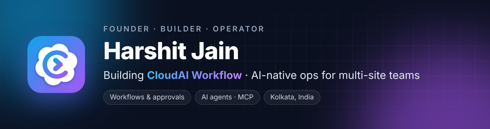

  

  
  

### Hi, I'm Harshit 👋

I'm the founder of **[CloudAI Workflow](https://cloudaiworkflow.com)**, an AI-native operations platform for multi-site businesses. I also run a B2B women's ethnic-wear distribution business across Surat and Kolkata — the real-world operation where everything I build gets tested first.

I build at the intersection of **operations software** and **AI agents**: workflow engines, approval systems, and MCP servers that let assistants like Claude and ChatGPT run business processes safely.

## 🚀 Featured work

<table>
<tr>
<td width="50%" valign="top">

### [CloudAI Workflow](https://github.com/rkstudiof-cloud/cloudai-workflow)
**Track requests from start to approval — across every site.**

Workflow builder, approvals & escalations, AI routing, attendance with geofencing, payroll handoff, and an **MCP server** with dry-run-first "safe fixes" for AI agents.

`TypeScript` `Next.js` `Supabase` `Azure` `MCP`

[Product overview →](https://github.com/rkstudiof-cloud/cloudai-workflow) · [Website →](https://cloudaiworkflow.com)

</td>
<td width="50%" valign="top">

### [model-router](https://github.com/rkstudiof-cloud/model-router)
**Open-source Claude Code plugin.**

Picks the model, effort and delegation for every message to cut credit use without losing quality. Locks a model per turn, escalates on repeated failures, and measures per-model correction rates from real usage.

`TypeScript` `Claude Code` `LLM routing`

[Repo →](https://github.com/rkstudiof-cloud/model-router) · [v0.5.0 release →](https://github.com/rkstudiof-cloud/model-router/releases)

</td>
</tr>
</table>

## 🧭 Background

- **Operator first.** Run day-to-day operations for a two-firm distribution business (RK Fashion, Surat · RK Studio, Kolkata) serving ~155 business customers through ~47 brokers.
- **Built the tools we needed.** Internal ERP work on ERPNext and Odoo, data pipelines into Supabase and BigQuery, then CloudAI Workflow to replace WhatsApp-and-spreadsheet operations.
- **AI-native workflow.** Work daily with coding agents (Claude Code, Codex) and build skills, plugins and MCP servers for them.

## 🛠️ Stack

  

**AI:** Claude & OpenAI APIs · Model Context Protocol (MCP) · Claude Code plugins & skills
**Business systems:** ERPNext · Odoo · BigQuery

## 📫 Get in touch

Building something in operations, workflow automation or AI agents? Want a walkthrough of the CloudAI Workflow codebase? Reach out on [LinkedIn](https://www.linkedin.com/in/harshitjain96) or via [cloudaiworkflow.com](https://cloudaiworkflow.com).

> Most of my work lives in private repositories — the contribution graph on this profile reflects that activity. Happy to walk through the code on request.
